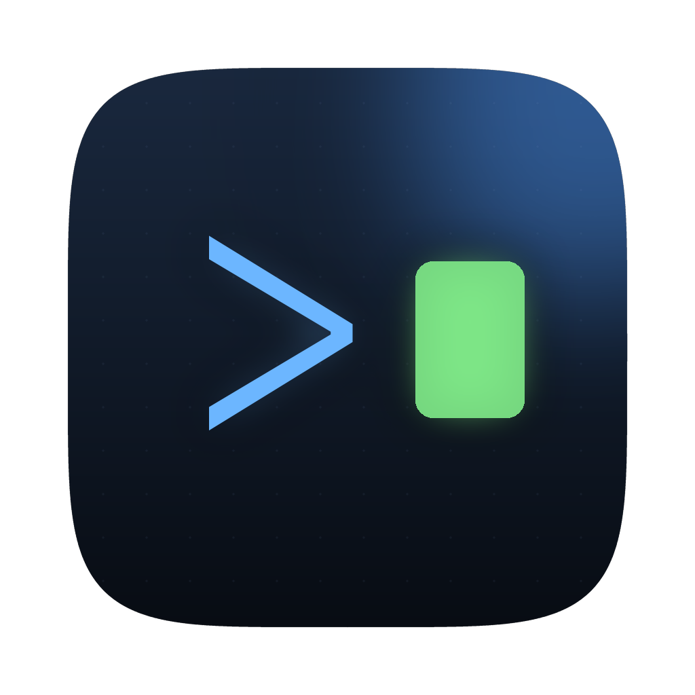
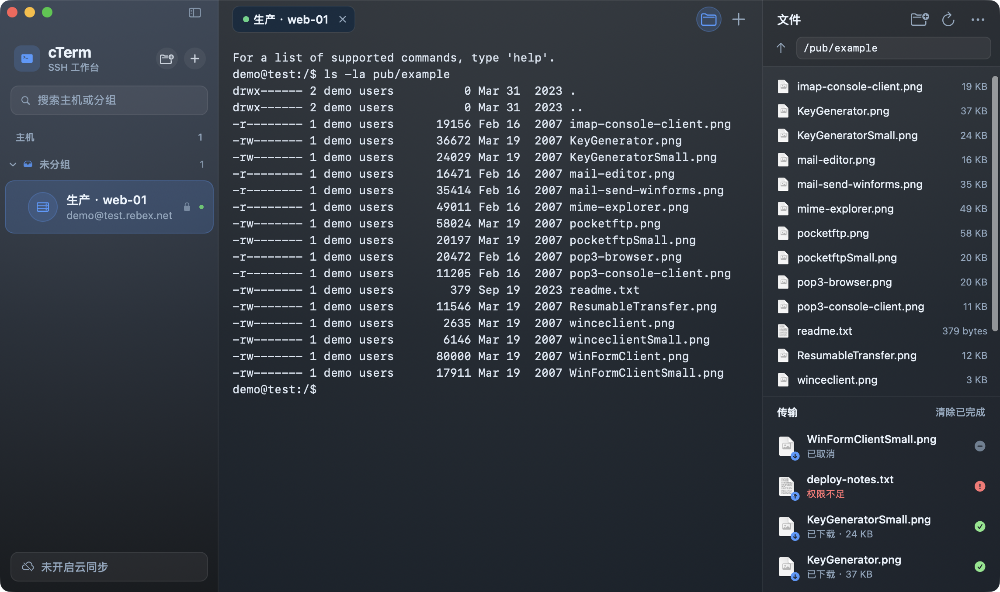
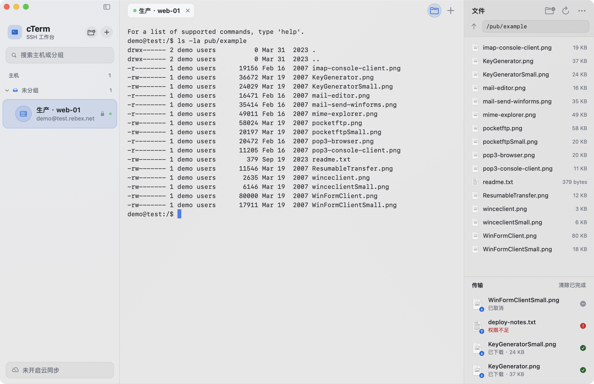
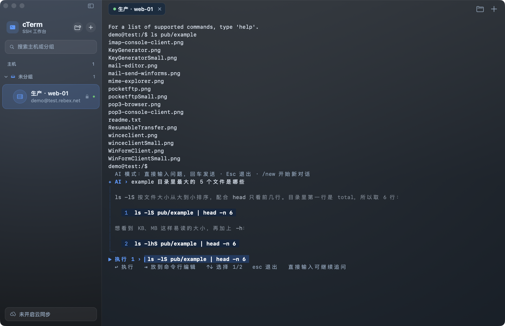
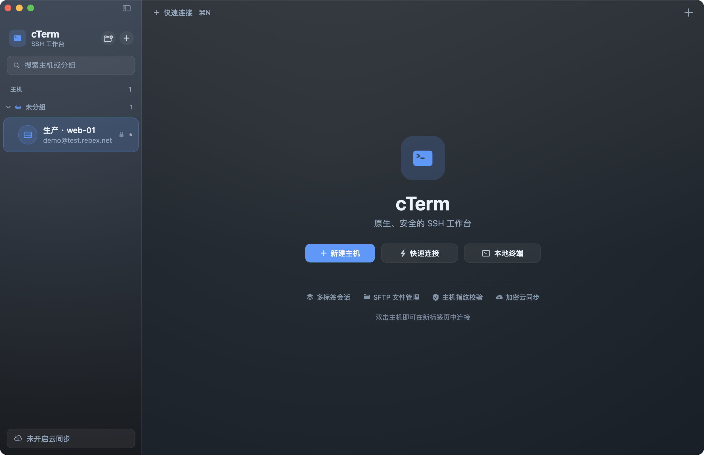
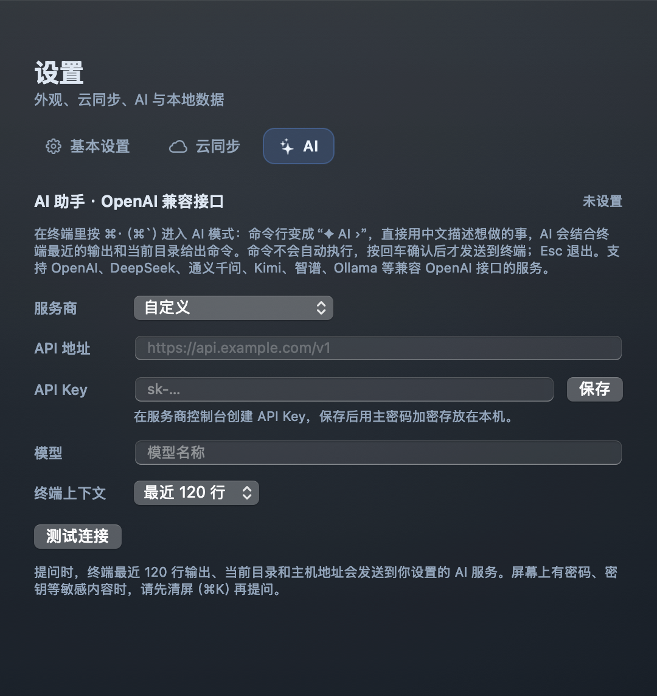
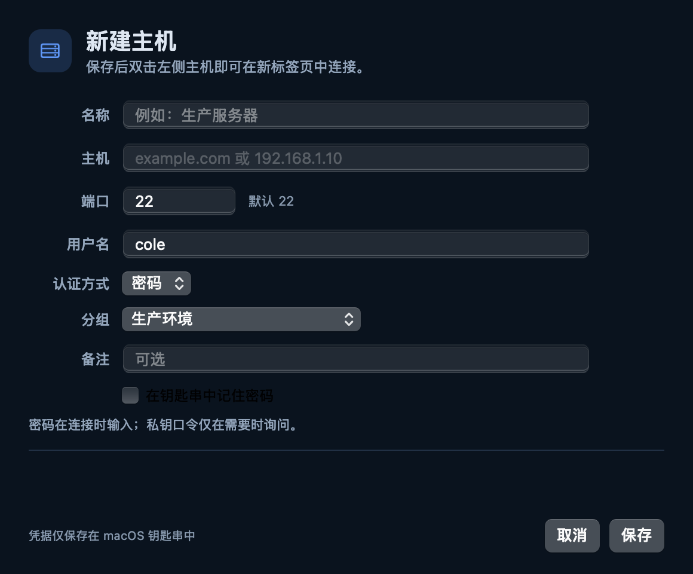
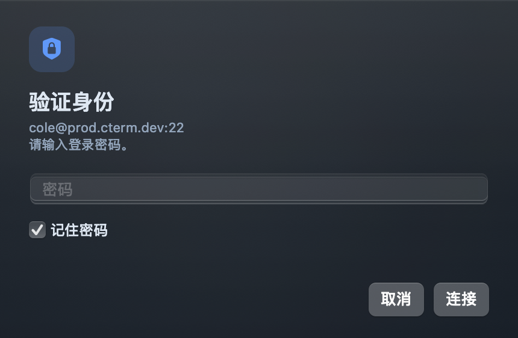
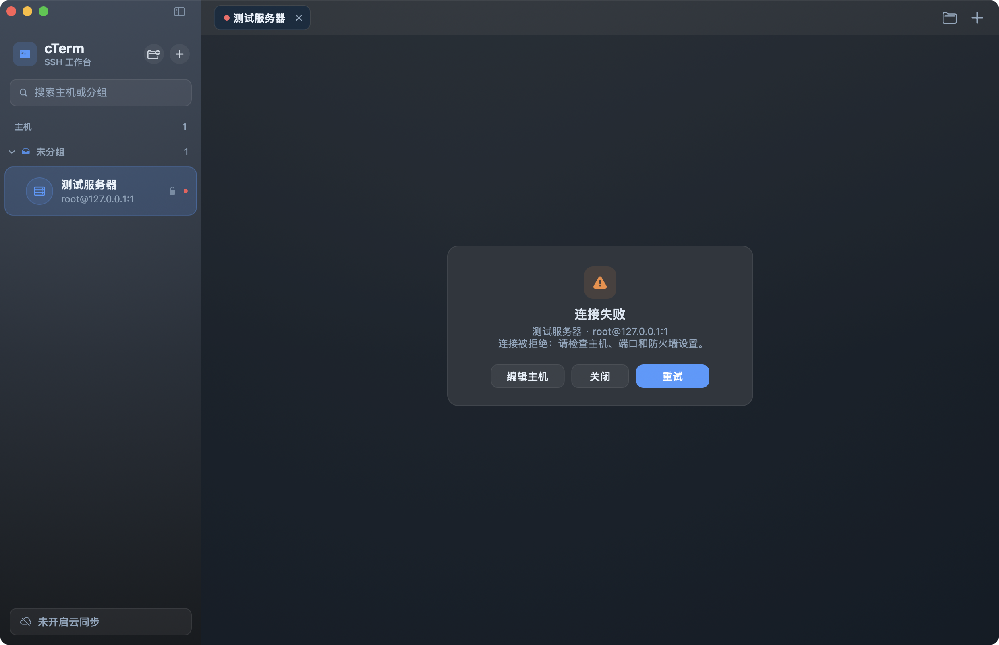
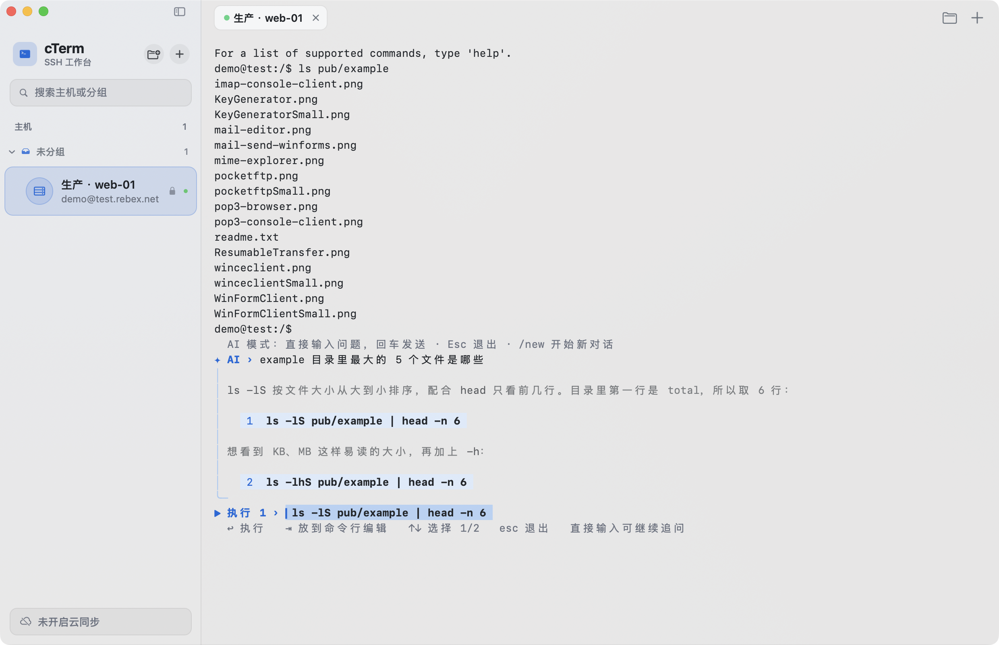

<p align="center">
  
</p>

<h1 align="center">cTerm</h1>
<p align="center"><strong>原生 Swift 远程 SSH 工作台 · SFTP 文件管理 · 终端内 AI 助手 · 多标签终端</strong></p>
<p align="center">macOS 15+ · Swift 6 · AppKit · SwiftNIO SSH · <a href="https://cterm.cqq.me">cterm.cqq.me</a></p>



## 简介

cTerm 是一个用 Swift 从零构建的 macOS 远程 SSH 客户端。它直接使用
[SwiftNIO SSH / Citadel](https://github.com/orlandos-nl/Citadel) 完成 SSH
握手、认证、PTY 和交互式 Shell，不把 `/usr/bin/ssh` 当作连接层；界面和终端渲染
全部由 AppKit + 自研 VT 解析器实现。

界面采用无原生标题栏的全尺寸窗口：只保留红黄绿三个系统按钮，左侧是主机分组菜单，
顶部是与其他控件保持一致的圆角标签。深色主题的标签区、终端和欢迎页共用一块
`NSVisualEffectView` 毛玻璃表面；浅色主题使用纯白背景，标签、卡片和侧栏保持相同的
圆角与层级。标签直接嵌入终端，没有额外的标题栏/分隔条。
终端支持 256 色/真彩色、中文与 emoji 宽字符、输入法、滚动回看、选择复制、
Bracketed Paste 和窗口缩放（缩放时长行会重新折行，不会被截断）。

在终端右侧可以打开 SFTP 文件面板，复用当前 SSH 连接浏览、传输和远程编辑文件；
按 ⌘· 可以直接在终端里进入 AI 模式，用中文描述需求，确认后再执行 AI 给出的命令。

## 功能

- **主机管理**：名称、主机、端口、用户名、密码或私钥、备注。
- **主机分组**：创建、重命名、删除分组；折叠/展开；把主机拖到分组或通过右键菜单
  移动；编辑主机时直接选择分组；搜索可按主机或分组名过滤。
- **一组多开**：同一台主机可以打开任意多个标签页；同名标签会自动编号，避免混淆。
- **原生 SSH 传输**：基于 SwiftNIO SSH/Citadel，支持密码和 OpenSSH 私钥认证。
- **密钥支持**：Ed25519 与 RSA 的 OpenSSH 私钥；加密私钥会在本机通过系统
  `ssh-keygen` 解锁，解锁后的临时文件权限为 `0600` 并立即删除。
- **主密码**：第一次保存主机、开启云同步或记住密码时创建主密码，之后每次启动输入一次（快速连接不保存任何凭据）。记住的密码/私钥口令、私钥副本、同步密码和 OneDrive 授权都保存在 `credentials.json` 中，用主密码加密（PBKDF2-SHA256 60 万轮 + AES-256-GCM）；主密码与同步密码相互独立。忘记主密码只能清除本机凭据，可通过云同步恢复。
- **加密云同步**：主机配置、记住的密码/口令以及私钥文件内容，用同步密码在本机加密（PBKDF2-SHA256 + AES-256-GCM）后同步到 OneDrive 的应用文件夹（`应用/cTerm`），云端只有密文。私钥副本只保存在 cTerm 自己的凭据文件中，不会写入 `~/.ssh`。
- **主机指纹校验**：首次连接采用 TOFU，显示 `SHA256:` 指纹；主机密钥变化时给出
  高风险警告并要求显式确认。指纹保存在 `known_hosts.json`。
- **SFTP 文件管理**：在终端右侧打开文件面板（⇧⌘B），复用当前标签的 SSH 连接，无需再次登录。
  浏览、上传、下载（支持与访达互相拖拽）、新建文件夹、重命名、删除；底部传输队列显示进度与速度，可取消。
  右键“编辑”会把文件下载到本机临时副本并用默认编辑器打开，每次保存自动传回原位置；
  如果服务器上的文件在此期间被改过，会询问覆盖、另存一份或放弃。
  右键还可修改权限（支持递归）、压缩为 zip，以及解压 zip / tar / tar.gz / tar.bz2 / tar.xz /
  tar.zst / gz / bz2 / xz / zst / 7z / rar；这些操作在服务器上执行，缺少对应工具时会提示安装命令。
- **AI 助手**：在终端里按 ⌘·（⌘`）进入 AI 模式，命令行变成 `✦ AI ›`，输入的内容不会发给 shell，
  而是连同终端最近的输出、当前目录一起发给 AI，回答直接打印在终端里。AI 给出的命令出现在确认行：
  ↩ 执行、⇥ 只输入不执行、↑↓ 在多条命令间切换、Esc 退出；也可以直接继续输入追问，`/new` 开始新对话。
  使用 OpenAI 兼容接口（`/chat/completions`，流式），在“设置 → AI”中选择服务商（OpenAI、DeepSeek、
  通义千问、Kimi、智谱、硅基流动、本机 Ollama）或自定义 API 地址，并填写模型名称；API Key 用主密码加密保存在本机。
- **多标签会话**：圆角标签；当前标签使用填充和细边框，hover 同样为圆角；关闭按钮与
  右侧 `+` 的 hover 为圆形。标签区与终端共享同一背景，没有独立标签栏边界；
  支持连接状态点、关闭/重连和标签页快捷键。
- **终端模拟器**：UTF-8、CJK 宽字符、组合字符、256 色与真彩色、备用屏幕、滚动区域、
  光标样式、括号粘贴、OSC 标题、窗口大小同步、8000 行回滚。
- **编辑体验**：鼠标选择、双击选词、三击选行、复制/粘贴、拖入文件路径、输入法预编辑。
- **设置**：分为“基本设置”“云同步”“AI”三个标签页；帮助菜单中可打开官方网站。
- **外观**：深蓝 / 浅色两套主题，默认跟随 macOS 系统外观，可在设置或“主题”菜单中固定。浅色主题使用纯白背景，字体大小可调。
- **深色毛玻璃**：深色主题的侧栏、标签区和终端/欢迎页使用系统 vibrancy 材质 +
  蓝色半透明渐变、柔和反射和细边框；浅色主题按需求使用纯白背景，保持平滑干净的
  表面，不使用颗粒/噪点纹理。
- **自定义 chrome**：无标题栏，只保留系统交通灯；全尺寸内容、可拖拽的自定义顶栏；
  侧栏可折叠，窗口大小会记住。

## 截图

**SFTP 文件管理**：右侧文件面板与底部传输队列，和终端共用一个 SSH 连接（浅色主题）。



**终端内 AI 助手**：按 ⌘· 进入 AI 模式，回答直接打印在终端里；命令编号列出，确认行回车才执行。



| 欢迎页 | AI 设置 |
| --- | --- |
|  |  |

| 新建主机 | 身份验证 |
| --- | --- |
|  |  |

| 连接失败 | 浅色主题 |
| --- | --- |
|  |  |

## 系统要求

- macOS 15.0 或更高版本（Citadel 的 PTY 客户端 API 需要 macOS 15）。
- Xcode 16 / Swift 6 工具链（也支持匹配的 Command Line Tools）。
- 首次构建需要网络访问以解析 Swift Package 依赖。

## 构建与运行

```bash
# Release 构建 + 组装 dist/cTerm.app
./build.sh

# 启动
open dist/cTerm.app
```

`build.sh` 会优先使用已安装的 Xcode 工具链，并把 SwiftPM/Clang 缓存放在
`.build/caches`，避免沙箱和权限问题。

开发调试：

```bash
swift build
swift run cTerm

# 终端核心单元测试（需要完整 Xcode 提供 XCTest）
swift test
```

当前 `Package.swift` 的目标是 arm64 macOS；在 Apple Silicon 上构建最顺畅。
若使用纯 Command Line Tools 且其 SDK 与编译器版本不匹配，请安装 Xcode，
或者让 `DEVELOPER_DIR` 指向完整 Xcode。

## 使用

1. 点击右上角圆形 **+** 或左侧空状态里的“添加主机”。
2. 填写名称、主机、端口、用户名；认证方式选择“密码”或“私钥”；在“分组”中选择
   已有分组（可先点侧栏标题旁的文件夹按钮新建分组）。
3. 保存后双击左侧主机即可打开一个**新标签页**；重复双击同一主机会继续开新标签页。
   标签区右侧的 **+** 会为当前选中的主机打开新标签页（未选中主机时打开快速连接）；
   也可以使用 `⌘T`，或点击左上角的“快速连接”/`⌘N`。
4. 管理分组：右键分组可重命名/删除/在该分组中新建主机；把主机行拖到分组标题即可
   移动；右键主机选择“移动到分组”也可以。删除分组只会把主机移到“未分组”，不会
   删除主机。
5. 首次连接会显示主机密钥指纹，确认与服务器管理员提供的一致后点击“信任并连接”。
6. 密码/私钥口令会在需要时通过独立面板询问；勾选“记住密码”可免去下次输入。

### SFTP 文件

1. 连接成功后点击标签区右侧的文件夹按钮，或按 `⇧⌘B`，在终端右侧打开文件面板。
2. 双击文件夹进入，`⌘↑` 或路径栏左侧的 ↑ 返回上级；也可以在路径栏直接输入路径回车。
3. 从访达拖文件或文件夹到面板即可上传，从面板拖到访达即可下载；传输进度显示在底部队列，可单个取消。
4. 右键文件可以：编辑（用本机编辑器打开，保存后自动传回）、下载、重命名、删除、修改权限、
   压缩为 zip、解压，以及“在终端中前往此处”。

### AI 助手

1. 打开“设置 → AI”，选择服务商（或自定义 API 地址），填写 API Key 和模型名称，点“测试连接”。
2. 在终端里按 `⌘·`（英文键盘为 ``⌘` ``），命令行变成 `✦ AI ›`，用中文描述想做的事后回车。
3. 回答打印在终端里，最后一行是确认行：`↩` 执行、`⇥` 放到命令行编辑、`↑↓` 切换命令、`Esc` 退出；
   直接输入文字可以继续追问，输入 `/new` 开始新对话。
4. AI 只会看到终端最近的输出（默认 120 行）、当前目录和主机地址；命令必须由你确认后才会发送到 shell。

## 快捷键

| 快捷键 | 功能 |
| --- | --- |
| `⌘N` | 快速连接 |
| `⇧⌘N` | 新建主机 |
| `⌘T` | 新建标签页 |
| `⌘W` | 关闭标签页（无标签时关闭窗口） |
| `⇧⌘W` | 关闭窗口 |
| `⌘R` | 重新连接当前会话 |
| `⇧⌘D` | 断开当前会话 |
| `⇧⌘]` / `⇧⌘[` | 下一个 / 上一个标签页 |
| `⌘1`–`⌘9` | 跳转到指定标签页 |
| `⌘K` | 清空屏幕与回滚缓冲 |
| `⌘C` / `⌘V` / `⌘A` | 复制 / 粘贴 / 全选 |
| `⌘=` / `⌘-` / `⌘0` | 放大 / 缩小 / 恢复字号 |
| `⌃⌘S` | 折叠 / 展开侧边栏 |
| `⇧⌘B` | 显示 / 隐藏 SFTP 文件面板 |
| `⌘·`（``⌘` ``） | 进入 / 退出终端内 AI 模式 |
| `⌘,` | 设置 |

终端内：

- `⌘C` 在没有选区时会向远端发送 `Ctrl-C`。
- `Option` 作为 Meta 键发送 `ESC` 前缀；`Ctrl` 组合键按终端控制字符发送。
- `⇧PageUp` / `⇧PageDown`：本地回滚。
- 拖入文件：自动转义并插入文件路径。
- 支持括号粘贴、输入法预编辑、窗口大小变化同步到远端 PTY。

## 数据与凭据

| 内容 | 位置 |
| --- | --- |
| 主机档案与分组 | `~/Library/Application Support/cTerm/hosts.json`（权限 `0600`，版本化 JSON） |
| 已知主机指纹 | `~/Library/Application Support/cTerm/known_hosts.json`（权限 `0600`） |
| 密码/私钥口令、私钥副本、同步密码、OneDrive 授权 | `~/Library/Application Support/cTerm/credentials.json`（主密码加密，权限 `0600`） |
| 已解锁私钥临时文件 | 私有临时目录 `0700`，文件 `0600`，读取后立即删除 |
| AI 服务 API Key | 同在 `credentials.json`（主密码加密）；API 地址和模型名称保存在偏好设置中 |
| 远程编辑的本地副本 | `~/Library/Caches/cTerm/edit/`（每个文件一个 `0700` 目录，停止编辑后删除；未同步的修改会保留） |

`hosts.json` 不保存密码或口令。删除主机时，会同时删除该主机记住的密码或口令。

### 主机密钥与安全

- 首次连接使用 Trust On First Use（TOFU），不会静默接受未知主机。
- 指纹以 OpenSSH 公钥的 SHA-256 计算，并在信任确认面板中展示。
- 如果同一主机的密钥发生变化，面板会显示旧/新指纹，并使用更醒目的警告样式。
- release 构建不包含任何自动信任/调试后门；主机密钥校验委托只通过用户确认才会写入。
- 加密私钥的解锁使用 macOS 自带的 `/usr/bin/ssh-keygen`。这是为了兼容新版
  OpenSSH 的 bcrypt 参数；SSH 传输本身仍由纯 Swift 协议栈完成。

## 已知限制

当前版本聚焦“稳定可用的 SSH 终端”，以下功能尚未实现：

- 不支持 keyboard-interactive / 2FA 动态口令（SwiftNIO SSH 0.3 的认证 API 限制）。
- 不支持 ssh-agent、`~/.ssh/config` 自动导入、ProxyJump/跳板机。
- 不支持端口转发、会话录制。
- 私钥仅支持 OpenSSH 格式的 Ed25519 与 RSA；ECDSA、PuTTY `.ppk`、旧式 PEM 私钥暂不支持。
- SFTP 暂不支持断点续传；修改权限、压缩和解压通过 SSH 在服务器上执行命令完成，需要对应工具。
- AI 助手只支持 OpenAI 兼容的 `/chat/completions` 接口；全屏程序（vim、top 等）运行时不能进入 AI 模式。
- 主机指纹使用 cTerm 自己的 `known_hosts.json`，不会读取 OpenSSH 的
  `~/.ssh/known_hosts`。
- 终端不向远端上报鼠标事件；滚轮在备用屏幕中按方向键滚动。

## 项目结构

```
Sources/
  TerminalCore/          VT100/xterm 网格、解析器、颜色、Unicode 宽度
  cTerm/
    Models/              主机档案、JSON 存储、凭据文件
    SSH/                 SSH 连接、PTY、主机指纹、私钥解析、SFTP 会话、传输队列、远程编辑
    AI/                  OpenAI 兼容客户端、对话与终端上下文、AI 设置
    Sync/                OneDrive 加密云同步
    UI/                  AppKit 界面、终端渲染、SFTP 面板、终端内 AI 模式、主题、设置
    AppDelegate.swift    菜单栏与生命周期
Tests/
  TerminalCoreTests/     终端核心测试
Resources/               应用图标与 Info.plist
Screenshots/             README 截图
scripts/make_icon.py     图标生成脚本（Pillow）
```

## 测试状态

- `swift test`：终端核心测试（解析、SGR、滚动、备用屏幕、宽字符、缩放与重新折行、
  光标、OSC、粘贴模式等），需要完整 Xcode 提供 XCTest。
- SFTP：Debug 构建的冒烟测试在本地 sshd 上覆盖上传/下载（含目录与取消）、重命名、删除、
  远程编辑同步与冲突、权限、压缩与各种格式的解压；只读服务器与符号链接另有检查。
- AI：Debug 构建内置模拟的 OpenAI 流式接口，覆盖消息与上下文、多轮历史、内容过滤、401、
  网络不可达和中途停止，以及终端内 AI 模式的输入、确认与执行流程。
- 已在 macOS 26.6 / Swift 6.4 上完成 Release 构建，并验证窗口缩放、标签页多开、
  分组持久化与旧版 `hosts.json` 迁移。
- 已通过真实服务器 `test.rebex.net` 验证密码认证、SSH 握手、PTY 会话、键盘输入、
  256 色输出和主机指纹记录。
- Debug 构建还包含离屏 UI 快照与 SSH 冒烟测试入口，便于维护者做视觉回归；这些
  代码不会编译进 release。

## 第三方

SSH 协议栈依赖 Citadel / SwiftNIO SSH / SwiftNIO / swift-crypto，详见
[THIRD_PARTY.md](THIRD_PARTY.md)。cTerm 自身以 MIT 许可证发布，见 [LICENSE](LICENSE)。
